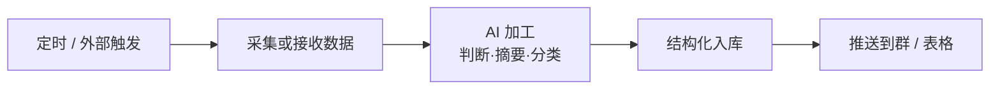
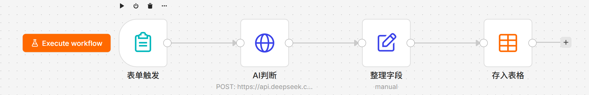
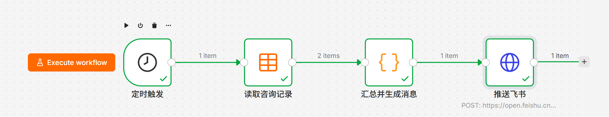
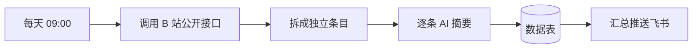

# 业务自动化工作流作品集

用 [n8n](https://n8n.io) 搭建的自动化工作流，每个都解决一个具体的业务问题。工作流文件可直接导入使用。

## 这套东西在做什么

一句话：把「每天要手工重复整理的事」变成自动的。

所有工作流都是同一条骨架，换数据源和字段就是一个新场景：



## 仓库结构

```
├── README.md
├── workflows/           工作流 JSON，可直接导入 n8n
├── images/              画布截图
└── docs/
    └── 搭建踩坑记录.md   搭建过程中遇到的 14 个坑与解决办法
```

## 工作流清单

### 01 客户咨询自动整理

**解决的问题**：客户咨询散在微信、电话和口头介绍里，谁问过什么、哪条值得马上跟，大多靠记忆。一忙就容易漏掉真想买的人。

**做了什么**：客户在手机表单里填需求，系统自动判断这条值不值得马上跟进，把当天的记录汇总成一条日报推送到飞书群。全程不用人工整理。

**表单收集链路**：客户填表 → AI 判断等级并提炼要点 → 入库



**每日日报链路**：定时读取当天记录 → 汇总成一条消息 → 推送飞书群



> 第二张截图里带着绿勾和 item 计数，是一次真实执行成功后的画布。

**实际产出**（客户在群里收到的日报）：

```
📋 客户咨询日报 · 2026-10-12
今日新增 2 条，其中高意向 1 条

1. 张先生｜低
   只是随便看看，无明确预算、时间或具体需求。
   联系：138****0001

2. 李女士｜高
   预算 800 元，急需快速整理门店评价的工具
   联系：138****0002
```

**技术要点**

- DeepSeek 判断意向等级，输出「等级｜要点」单行格式，再用表达式解析成两列
- 表单用 n8n 内置 Form Trigger，发布后自动生成公网可访问的填写链接
- 日报用 Code 节点按日期过滤当天记录、统计高意向数量、拼装消息文本
- 时区处理：Code 节点里的 `new Date()` 走 UTC，需手动加 8 小时才是北京时间

**文件**

- `workflows/01-客户咨询自动整理-表单收集.json`
- `workflows/01-客户咨询自动整理-每日日报.json`

---

### 02 B站热门榜 AI 摘要推送

**解决的问题**：每天手动刷热门榜、复制标题和数据到表格，费时且零散。

**做了什么**：每天定时抓取 B 站热门榜前 10 条视频，逐条生成一句话摘要，结构化入库，并汇总推送到飞书群。



**技术要点**

- 数据源选型：B 站接口国内直连、无需鉴权、返回结构化 JSON，适合作为演示数据源
- 拆分数组用 Split Out 节点，字段映射用 Set 节点（注意 3.2 版本的值属性名与类型绑定）
- 定时器在 n8n 2.x 中建议用 Custom (Cron) 模式，避免可视化配置丢失参数

**文件**：`workflows/02-B站热门榜AI摘要推送.json`

## 国内环境的数据源可用性

搭建过程中实测过的网络可用性，供参考（测试环境：中国大陆家庭宽带）：

| 服务 | 可用性 | 说明 |
|---|---|---|
| 飞书 open.feishu.cn | 可用 | 群自定义机器人 Webhook、开放平台 API |
| 企业微信 qyapi.weixin.qq.com | 可用 | |
| DeepSeek API | 可用 | 国内直连，延迟 100-200ms |
| 阿里云百炼 dashscope | 可用 | |
| B 站公开 API | 可用 | 无需鉴权 |
| 腾讯文档、金山文档 | 可用 | |
| 36氪、少数派 RSS | 可用 | |
| Google 全家桶 | **不可用** | Sheets / Drive / OAuth 全部超时 |
| Notion API | **不可用** | 超时 |
| api.n8n.io 社区节点目录 | 超时 | 不影响已安装的节点工作 |

结论：国内环境下做自动化，**数据主体和通知渠道选国内服务，AI 走 DeepSeek 或通义**，可以完全绕开网络问题。

## 部署方法

### 环境要求

- Docker Desktop（或任何支持 Docker 的环境）
- n8n 2.x

### 启动 n8n

```bash
docker run -d --name n8n --restart unless-stopped \
  -p 5678:5678 \
  -e GENERIC_TIMEZONE="Asia/Shanghai" \
  -e TZ="Asia/Shanghai" \
  -e N8N_SECURE_COOKIE=false \
  -v n8n_data:/home/node/.n8n \
  n8nio/n8n:latest
```

> 国内网络拉取镜像需要走镜像源，例如把镜像名换成 `docker.m.daocloud.io/n8nio/n8n`。

浏览器打开 `http://localhost:5678` 完成初始化。

### 导入工作流

1. 打开任意工作流进入编辑器
2. 点顶部工作流名右侧的 `⋯` 菜单 → **Import from File**
3. 选择 `workflows/` 下的 JSON 文件

### 必做的三项配置

**一、AI 凭据**

在 Credentials 里新建 **DeepSeek** 类型凭据，填入 API Key（原始密钥，不需要加 `Bearer` 前缀）。

**二、数据表**

工作流依赖两个数据表，需要先在 Data tables 里建好：

| 表名 | 列 |
|---|---|
| 客户咨询记录 | 姓名、联系方式、需求描述、意向等级、需求要点、提交时间 |
| 热门视频榜 | 标题、UP主、播放量、点赞数、视频链接、抓取时间、AI总结 |

列的类型：除播放量和点赞数为 Number 外，其余均为 String。**表名和列名必须完全一致**，否则节点会找不到。

**三、飞书机器人**

在飞书群里添加「自定义机器人」，安全设置选「自定义关键词」，关键词需与推送消息内容匹配（例如消息含「日报」则关键词设为 `日报`）。把拿到的 Webhook 地址填进「推送飞书」节点。

### 常见问题

**推送节点显示成功但群里没消息**

飞书在消息被拒时仍返回 HTTP 200，错误码藏在响应体里。检查节点返回内容中的 `code` 字段，`0` 才是成功。

**定时任务到点没执行**

n8n 2.x 需要点 **Publish** 后定时器才生效。另外改完工作流要重新 Publish，发布的是「点发布那一刻的版本」。

**定时器的执行时间和配置的不一样**

可视化配置模式下，`triggerAtMinute` 参数可能在保存时丢失，n8n 会用一个根据节点 ID 算出的伪随机分钟数兜底。改用 Custom (Cron) 模式写死表达式可以避免。

## 关于

如果你有类似的重复性工作想自动化，或者想了解某个工作流的实现细节，欢迎联系。

微信：qsl030710
